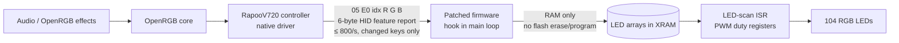
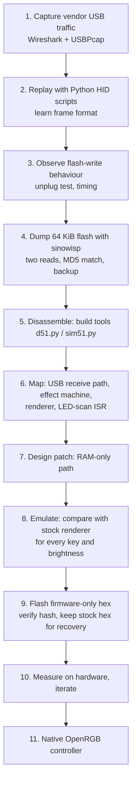
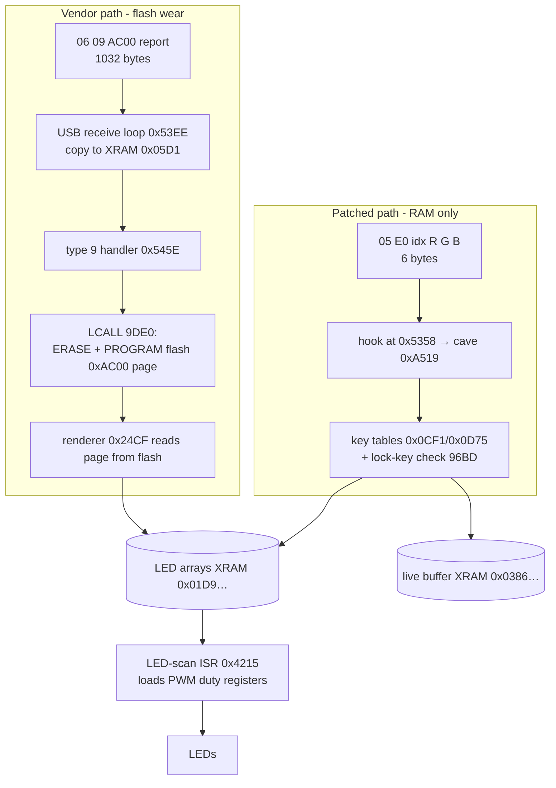
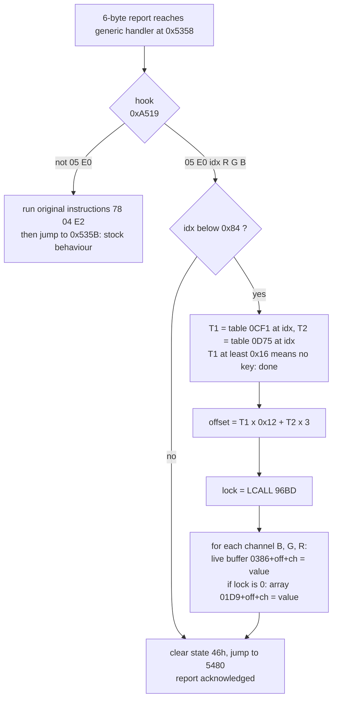
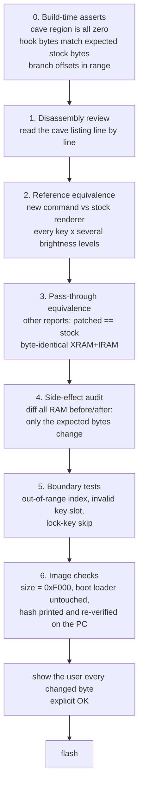
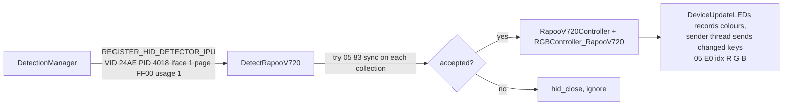

# Real-time per-key RGB on a BYK816 (Sinowealth-class 8051) keyboard without flash wear

### Reverse engineering, firmware patching and native OpenRGB support — tested on the **Rapoo V720**

> **Status:** working end-to-end on one keyboard (Rapoo V720, USB `24AE:4018`). Everything marked *verified* was measured on that keyboard. Everything about *other* keyboards is a reasoned expectation, **not** tested. See [§15](#15-porting-to-other-byk816--sinowealth-keyboards).

> **Scope:** this repository contains this write-up, the helper scripts (`scripts/`, MIT) and the OpenRGB driver sources (`OpenRGB Controller/`, GPL-2.0-or-later). **No firmware images are published** (they contain the vendor's firmware): you dump your own keyboard and build the patched image from your dump with the scripts. **The scripts are a guideline, not exact or supported tools** — they are what was used on one keyboard, tidied up, and will need adjusting elsewhere. Byte-level patch details are in [FIRMWARE-PATCHES.md](FIRMWARE-PATCHES.md) and the command spec in [PROTOCOL.md](PROTOCOL.md).

> **Risk notice:** flashing modified firmware can permanently brick a keyboard. Follow the safety process in [§12](#12-virtual-testing-and-safety-process-do-this-before-flashing) and keep a verified stock dump. You do this at your own risk. This information is provided as-is, without warranty or support.

---

## Table of contents

1. [TL;DR](#1-tldr)
2. [Test hardware and tools](#2-test-hardware-and-tools)
3. [The problem: why real-time lighting was impossible](#3-the-problem-why-real-time-lighting-was-impossible)
4. [Approach overview](#4-approach-overview)
5. [Chip and memory map](#5-chip-and-memory-map)
6. [USB protocol (as reverse engineered)](#6-usb-protocol-as-reverse-engineered)
7. [How a frame reaches the LEDs](#7-how-a-frame-reaches-the-leds)
8. [Firmware map](#8-firmware-map)
9. [Dead ends (v1–v5) and what they taught](#9-dead-ends-v1v5-and-what-they-taught)
10. [The final patch (v6/v7) and the reliability patches (v8/v9)](#10-the-final-patch-v6v7-and-the-reliability-patches-v8v9)
11. [Measurements](#11-measurements)
12. [Virtual testing and safety process](#12-virtual-testing-and-safety-process-do-this-before-flashing)
13. [Flashing, verifying and recovering](#13-flashing-verifying-and-recovering)
14. [Native OpenRGB driver](#14-native-openrgb-driver)
15. [Porting to other BYK816 / Sinowealth keyboards](#15-porting-to-other-byk816--sinowealth-keyboards)
16. [Limitations and open questions](#16-limitations-and-open-questions)
17. [Legal and ethics](#17-legal-and-ethics)
18. [Appendices](#18-appendices)

---

## 1. TL;DR

- The vendor software and its USB protocol (`06 09` frames) store every lighting frame **in the keyboard's flash memory** (erase + program of a 1 KiB page per frame). Streaming frames through that path (e.g. for a music visualizer) would wear the flash out.
- We dumped the keyboard's 64 KiB flash, disassembled it, built a small 8051 emulator, and understood the receive path, the effect engine, the renderer and the LED-scan interrupt.
- We added **one tiny new USB command** in unused flash space — `05 E0 <key> <R> <G> <B>` — that writes a key's colour **directly into the RAM buffers the LED scan reads**. It never touches flash. The patch is **314 bytes** (3-byte hook + 311-byte routine).
- The patch was verified in an emulator against the firmware's own renderer for all 132 key positions before it was ever flashed.
- A **native OpenRGB controller** (5 files, in `OpenRGB Controller/`) exposes the keyboard as a real keyboard with a 6×22 matrix and 104 named keys, so every OpenRGB effect and the Effects-plugin audio visualizer work unmodified.
- Measured: ~3,400 tiny reports/s accepted, a full 104-key rainbow at **~28.6 fps**, no flicker.
- Heavy lighting traffic caused two keyboard side effects: **stuck keys** (a lost key-*release* report) and **missed key presses**. Two small follow-up patches fix them: **v8** (release guard) removed stuck keys completely; **v9** (guard + held-key resend) cut missed presses from ~13 per 800 characters to ~1 (a typo-level rate) even at 800 reports/s, and no misses were seen at 2000/s. The driver defaults to **1600 reports/s**.



---

## 2. Test hardware and tools

| Item | Value |
|---|---|
| **Keyboard** | **Rapoo V720**, wired USB, ANSI 104 keys + 4 extra keys above the numpad (Fn, Mute, Win Lock, M = software-mode key) |
| USB IDs | VID `0x24AE`, PID `0x4018` |
| Main chip (marking read from the board) | `BYK 816 / NRA28 / 2213` (Sinowealth-family 8051 MCU; the SH68F89/90 class) |
| Flash | 64 KiB: app `0x0000–0xEFFF`, ISP boot loader `0xF000+` |
| Settings storage | external I²C EEPROM (settings pages are sent with `06 03`) |
| Host OS | Windows (Python + `hid` package, USBPcap/Wireshark for capture) |
| Flasher | `sinowisp` (Sinowealth ISP flasher; its README lists the BYK 816) (`sinowisp write -d ciy-x77 --vendor_id 0x24ae --product_id 0x4018 <hex>`) — the flasher profile name `ciy-x77` was what worked for this chip |
| Analysis | custom minimal 8051 disassembler (`d51.py`) and interpreter (`sim51.py`), plus emulator-based tests (all in `scripts/`) |
| RGB software | OpenRGB 1.1 (master at the time), Qt 6.8.3, Visual Studio 2022 Build Tools + Windows SDK |

> The vendor software's own lighting and the keyboard's behaviour when unplugged were also observed (e.g. a frame sent through the vendor path survived a 5-second unplug — proof that it is stored in non-volatile memory).

---

## 3. The problem: why real-time lighting was impossible

The vendor software "paints" per-key colours by sending whole pages of lighting data. Capturing its USB traffic and replaying it showed:

1. A page of **1024 bytes** (`0x400`) is sent as one 1032-byte HID feature report (8-byte header + payload).
2. The firmware **erases and reprograms a flash page** for each such frame (`0xAC00` for the layer-0 painting).
3. Flash endurance is limited (commonly quoted on the order of 10⁴–10⁵ erase cycles for embedded flash of this class; check your chip's datasheet). A visualizer at 30 fps would perform ~108,000 page erases per hour on the same page.

Result: real-time effects through the vendor protocol = **destroying the keyboard's flash within hours/days**. Hence the firmware patch.

Additionally, the vendor path blanks / disturbs the display while it runs (see [§9](#9-dead-ends-v1v5-and-what-they-taught)) so it could not give smooth frames even if wear were no concern.

---

## 4. Approach overview



Key decisions:

- **Do not touch the boot loader** (`0xF000+`): flash only `0x0000–0xEFFF` (61,440 bytes). The ISP boot loader stays intact so recovery is always possible.
- **Patch in unused flash** (an all-zero region), jump to it from one place, and **fall through to the original code** for every report we don't own. Stock behaviour is preserved bit-for-bit for everything else (tested).
- **Never trust, always emulate first.** No byte was written to the keyboard without a prior emulator run and the user explicitly approving the byte list.

---

## 5. Chip and memory map

The MCU is an 8051-core part with very little RAM. Everything in the patch had to fit this budget.

```
CODE / FLASH (64 KiB)                         XRAM (external-style RAM, on-chip)
┌───────────────────────────┐ 0x0000          ┌──────────────────────────┐ 0x0000
│ reset, vectors            │                 │ firmware variables       │
│ LJMP 0x4215 at 0x0003     │ ← only ISR      │ ...                      │
│ ...                       │                 │ 0x01D9  LED arrays (A/B) │ ← what the scan ISR displays
│ effect machine  0x17B0    │                 │ 0x0386  live buffer      │
│ renderer        0x24CF    │                 │ 0x05D1  USB staging buf. │
│ USB receive     0x53EE    │                 │ ...                      │
│ LED scan ISR    0x4215    │                 ├──────────────────────────┤ 0x0AFF
│ brightness tbl  0x00EE    │                 │ USB RAM (endpoint bufs)  │ 0x0B00–0x0BFF
│ key tables 0CF1 / 0D75    │                 └──────────────────────────┘
│ ...                       │
│ 0xA4F3–0xA801 UNUSED (00) │ ← patch lives at 0xA500
│ 0xAC00 layer-0 painting   │ ← vendor frames are stored here (flash page)
│ ...                       │
├───────────────────────────┤ 0xEFFF
│ ISP boot loader (0xF000+) │ ← never touched / never flashed by us
└───────────────────────────┘ 0xFFFF
IRAM: 0x46 = USB state variable, 0x47–0x4A = packet header, 0xB7 = brightness index
```

| Region | Address | Purpose |
|---|---|---|
| Reset / interrupt vectors | `0x0000…` | only vector `0x03` (INT0 position) is used |
| LED-scan ISR | `0x4215` | loads PWM duty registers from the XRAM arrays |
| Brightness table | `0x00EE` | `00 02 05 07 0A` — scale factors in tenths (0 %, 20 %, 50 %, 70 %, 100 %) |
| Key-position tables | `0x0CF1`, `0x0D75` | map key index → (matrix row-ish `T1`, column-ish `T2`) |
| Effect dispatcher | `0x17B0–0x182F`, table `0x1833` | effect ids `0x24`–`0x28` … |
| Renderer (layer painting) | `0x24CF` → per-key `0x24E0`, tail `0x2864–0x29C0` | reads painted page and fills LED arrays |
| USB receive loop | `0x53EE` | copies packets into XRAM `0x05D1`, header in IRAM `0x47–0x4A` |
| Type dispatch | `0x5438–0x5467` | report-type switch (type 9 → painting write) |
| 6-byte report chain | `0x52AF` → generic copy at `0x5358` | where our hook attaches |
| Free space used by patch | `0xA500–0xA63D` | 318 bytes (all `00` in the stock dump) |
| Vendor painting page | `0xAC00` (1 KiB) | layer-0 painting, **erase+program per frame** |
| Boot loader | `0xF000+` | ISP; untouched |

---

## 6. USB protocol (as reverse engineered)

The keyboard enumerates as a composite HID device. On Windows several HID *collections* appear; only one accepts the vendor feature reports.

| Collection (Windows path suffix) | Usage page / usage | Purpose |
|---|---|---|
| `MI_00` | `0x01 / 0x06` | boot keyboard |
| `MI_01 Col01, 02, 04, 07` | `0x01/0x80`, `0x0C/0x01`, `0x01/0x06`, `0x01/0x02` | system control, consumer, N-key keyboard, mouse |
| `MI_01 Col03`, `Col05`, `Col06` | `0xFF00 / 0x01` | vendor collections — **one** of them accepts report 5/6 |

The correct collection is found by **trying a harmless 6-byte report (`05 83 00 00 00 00`) and keeping the path that returns success**. Other paths reject it.

### 6.1 Vendor reports

| Report | Size | Layout | Notes |
|---|---|---|---|
| 5 | 6 bytes | `05 <cmd> …` | `05 83 00 00 00 00` = sync; `05 75`, `05 A5`, `05 5A`, `05 01` are further commands in the firmware's chain |
| 6 | 1032 bytes | `06 <type> <addr_hi> <addr_lo> 40 00 00 00` + 0x400 payload | type `09` = painting page write (flash!), type `03` = settings to the external EEPROM |

Frame/painting payload layout (type `09`, address `AC00`):

```
payload offset  0x000 ─ 0x083  plane 0  (blue)    index = row*22 + col
                0x084 ─ 0x107  plane 1  (green)
                0x108 ─ 0x18B  plane 2  (red)
```

The display only shows the painting if the *settings* (type `03`) select the painted/software mode — in our case by re-sending a settings block captured from the vendor software (not included in this repository: capture your own) with the **M** key lit.

### 6.2 The new command (the only protocol addition)

```
05 E0 <key index> <R> <G> <B>        (6-byte HID feature report, report ID 5)
         │
         └── 0 … 131 = row*22 + column of the 6×22 grid (invalid / non-key slots are ignored)
```

Behaviour: look up the key in the firmware's own tables, apply the firmware's lock-key rule, write B/G/R into both LED arrays and the live buffer. **No flash access.** Every other report is passed unchanged to the original handler.

---

## 7. How a frame reaches the LEDs



Array addressing, verified in the emulator with the stock renderer (e.g. key index 5):

```
array offset  = T1 * 0x12 + T2 * 3          (T1 = [0x0CF1 + idx], T2 = [0x0D75 + idx])
LED array     = XRAM 0x01D9 + offset + channel      (channel 0 = blue, 1 = green, 2 = red)
live buffer   = XRAM 0x0386 + offset + channel
stock scaling = value * T[IRAM 0xB7] / 10     (T = 00 02 05 07 0A at flash 0x00EE)
```

Lock keys (Caps/Num/Scroll lit while active) are protected by a check (`LCALL 96BD`, non-zero = key is lock-indicated): the stock renderer then skips the LED-array write. The patch keeps this behaviour (writes the live buffer, skips the arrays).

---

## 8. Firmware map

| Function (flash addr) | Role | Used by patch |
|---|---|---|
| `0x0003 → LJMP 0x4215` | only interrupt: LED scan | read-only reference |
| `0x4215` | LED-scan ISR; reads the `0x01D9` arrays (flag `29.5` selects the `0x01E2` half) | no change |
| `0x53EE` | USB receive loop (per 8-byte packet, waits on `TCON.4` via `0xA25F`) | no change |
| `0x5438–0x5467` | report-type dispatch | no change |
| `0x545E` | type 9 → `SETB 20.1; SETB 27.1; clear XRAM 0512; LCALL A461; LCALL 9DE0` | no change |
| `0x9DE0` | erase + program 0x400 bytes (**flash wear**) | avoided |
| `0x52AF` | 6-byte report chain: checks `05 75`, `05 A5`, `05 5A`, `05 01`, else generic copy at `0x5358` | **hook here** |
| `0x5358` | original `78 04 e2` (`MOV R0,#04; MOVX A,@R0`) — start of generic copy | **3 bytes replaced** |
| `0x5480 / 0x5485` | handler epilogue (`LJMP 5480` → ack, RET) | jumped to when handled |
| `0x24CF / 0x24DC / 0x24E0` | renderer: layer in R7 → clear → per-key loop | used as reference |
| `0x5534`, `0x5546` | helpers used by the scaling (multiply, then divide by 10 — role inferred from the call pattern) | called by patch (until v7) |
| `0x96BD` | lock-key check | called by patch |
| `0x0CF1`, `0x0D75`, `0x00EE` | tables | read by patch |

Effect ids: `0x24` (layer 0 painting; renderer R7=0), `0x25` (layer 6), `0x26–0x28` (animated; per-tick handlers `0x1E2C/1E3B/1E4A` → `0x649C`, R7=1..3). The "software mode" used here is probably effect `0x28`.

Important properties discovered:

- The receive/poll code is called **only from the main loop**; the ISR does not touch USB. Render/effect code never polls USB.
- There is **no spare ISR** — the LED scan is the only interrupt.
- XRAM is tiny (`0x0000–0x0AFF`), so the patch uses a handful of scratch bytes at `0x0130–0x0135` (found unused by static analysis; see [limitations](#16-limitations-and-open-questions)).

---

## 9. Dead ends (v1–v5) and what they taught

Each version was emulated, shown byte-by-byte to the user, flashed only on explicit approval, and tested on hardware.

| Ver | Idea | Result | Lesson |
|---|---|---|---|
| v1 | Hook the internal save path, mirror the frame at XRAM `0x0C00` | LEDs dark | `0x0C00` does not exist as XRAM on this chip (XRAM ends at `0x0AFF`; `0x0B00–0xBFF` is USB RAM) |
| v2 | Hold the planes in XRAM next to the live buffer | planes overlapped the live RGB buffer → abandoned | RAM budget is the main constraint |
| v3 | Tag the frame (`RTV2` at payload `0x318`), stage reads from the USB staging buffer (hook at `0x9DE0`) | frames displayed, **no flash write** (13 ms per frame proves no erase), but a strange pattern while streaming | the tag/staging idea works for wear; the glitch has another cause |
| v4 | Don't clear XRAM `0512` in the type-9 handler (suspected "effect restart") | no change | misdiagnosis |
| v5 | Render layer 0 in place after receiving (suspected render blanking) | no change | misdiagnosis |
| **finding** | Compare report sizes | **Full-size 1032-byte reports (129 packets, ~13 ms) disturb the LED scan** — a column of 4–5 keys stays at full brightness and moves each frame. **6-byte reports do not** (3,395 accepted/s, clean display) | The USB receive loop polls per 8-byte packet in the main loop and starves/disturbs the scan; any full-size frame glitches regardless of painting logic |
| v6 | New **tiny report** `05 E0 idx R G B` on stock firmware (v3–v5 changes dropped) | Perfect, ~28.6 fps full frame | the winning design |
| v7 | v6 with brightness scaling bypassed (2-byte change) | brighter, matches hardware mode | firmware multiplies by the keyboard's own brightness step in software mode |

Other findings along the way:

- Settings (`06 03`) go to an **external I²C EEPROM**; the display only shows the painting when settings select the painted mode.
- After toggling hardware/software mode with the stale-tag design the keyboard showed an "unfinished canvas" — the staging buffer kept a leftover tag and the renderer drew settings bytes as colours. Irrelevant once the tag design was dropped.
- Sending reports too fast makes the keyboard **miss key presses** and later **leave keys stuck**. An early cap of 800 reports/s reduced this but did not remove it; the real fixes are v8/v9 ([§10.6](#106-reliability-stuck-keys-and-missed-presses-v8-v9)).
- A flasher run once hung silently before enumerating; a Windows restart fixed it. Always replug the keyboard (≥ 5 s) after flashing — the flasher does not reboot it.

---

## 10. The final patch (v6/v7) and the reliability patches (v8/v9)

### 10.1 Design



### 10.2 The three-byte hook (the only edit to existing code)

| Address | Stock | Patched | Meaning |
|---|---|---|---|
| `0x5358` | `78 04 E2` | `02 A5 19` | `LJMP 0xA519` (hook); the original 3 bytes are re-executed at the end of the hook for non-matching reports, then `LJMP 0x535B` |

### 10.3 The routine (annotated disassembly of the cave, v7)

Scratch variables in XRAM: `0x0130/31` = array offset (hi/lo), `0x0132` = lock flag, `0x0133/34/35` = B, G, R.
In v6 the first routine at `0xA500` scales a colour by `T[B7]/10` exactly like the stock renderer; **v7 replaces its first two bytes (`FD 7C` → `FF 22`) so colours pass through unscaled** (the rest of that routine becomes dead code).

```
A500  ff        MOV   R7,A
A501  22        RET
A502  00        NOP
A503  78 b7     MOV   R0,#B7h
A505  e6        MOV   A,@R0
A506  90 00 ee  MOV   DPTR,#00EEh
A509  93        MOVC  A,@A+DPTR
A50A  ff        MOV   R7,A
A50B  7e 00     MOV   R6,#00h
A50D  12 55 34  LCALL 5534h
A510  7c 00     MOV   R4,#00h
A512  7d 0a     MOV   R5,#0Ah
A514  12 55 46  LCALL 5546h
A517  ef        MOV   A,R7
A518  22        RET
A519  78 04     MOV   R0,#04h
A51B  e2        MOVX  A,@R0
A51C  fe        MOV   R6,A
A51D  08        INC   R0
A51E  e2        MOVX  A,@R0
A51F  f5 82     MOV   DPL,A
A521  8e 83     MOV   DPH,R6
A523  e0        MOVX  A,@DPTR
A524  64 05     XRL   A,#05h
A526  60 03     JZ    A52Bh
A528  02 a6 38  LJMP  A638h
A52B  a3        INC   DPTR
A52C  e0        MOVX  A,@DPTR
A52D  b4 e0 02  CJNE  A,#E0h,A532h
A530  80 03     SJMP  A535h
A532  02 a6 38  LJMP  A638h
A535  a3        INC   DPTR
A536  e0        MOVX  A,@DPTR
A537  fa        MOV   R2,A
A538  a3        INC   DPTR
A539  e0        MOVX  A,@DPTR
A53A  c0 e0     PUSH  ACC
A53C  a3        INC   DPTR
A53D  e0        MOVX  A,@DPTR
A53E  c0 e0     PUSH  ACC
A540  a3        INC   DPTR
A541  e0        MOVX  A,@DPTR
A542  c0 e0     PUSH  ACC
A544  90 01 33  MOV   DPTR,#0133h
A547  d0 e0     POP   ACC
A549  f0        MOVX  @DPTR,A
A54A  90 01 34  MOV   DPTR,#0134h
A54D  d0 e0     POP   ACC
A54F  f0        MOVX  @DPTR,A
A550  90 01 35  MOV   DPTR,#0135h
A553  d0 e0     POP   ACC
A555  f0        MOVX  @DPTR,A
A556  ea        MOV   A,R2
A557  c3        CLR   C
A558  94 84     SUBB   A,#84h
A55A  40 03     JC    A55Fh
A55C  02 a6 32  LJMP  A632h
A55F  90 0c f1  MOV   DPTR,#0CF1h
A562  ea        MOV   A,R2
A563  25 82     ADD   A,DPL
A565  f5 82     MOV   DPL,A
A567  e4        CLR   A
A568  35 83     ADDC   A,DPH
A56A  f5 83     MOV   DPH,A
A56C  e4        CLR   A
A56D  93        MOVC  A,@A+DPTR
A56E  fe        MOV   R6,A
A56F  90 0d 75  MOV   DPTR,#0D75h
A572  ea        MOV   A,R2
A573  25 82     ADD   A,DPL
A575  f5 82     MOV   DPL,A
A577  e4        CLR   A
A578  35 83     ADDC   A,DPH
A57A  f5 83     MOV   DPH,A
A57C  e4        CLR   A
A57D  93        MOVC  A,@A+DPTR
A57E  fd        MOV   R5,A
A57F  ee        MOV   A,R6
A580  c3        CLR   C
A581  94 16     SUBB   A,#16h
A583  40 03     JC    A588h
A585  02 a6 32  LJMP  A632h
A588  ee        MOV   A,R6
A589  75 f0 12  MOV   B,#12h
A58C  a4        MUL   AB
A58D  fb        MOV   R3,A
A58E  aa f0     MOV   R2,B
A590  ed        MOV   A,R5
A591  75 f0 03  MOV   B,#03h
A594  a4        MUL   AB
A595  2b        ADD   A,R3
A596  fb        MOV   R3,A
A597  e4        CLR   A
A598  3a        ADDC   A,R2
A599  fa        MOV   R2,A
A59A  90 01 30  MOV   DPTR,#0130h
A59D  ea        MOV   A,R2
A59E  f0        MOVX  @DPTR,A
A59F  a3        INC   DPTR
A5A0  eb        MOV   A,R3
A5A1  f0        MOVX  @DPTR,A
A5A2  ed        MOV   A,R5
A5A3  ff        MOV   R7,A
A5A4  ee        MOV   A,R6
A5A5  fd        MOV   R5,A
A5A6  12 96 bd  LCALL 96BDh
A5A9  90 01 32  MOV   DPTR,#0132h
A5AC  ef        MOV   A,R7
A5AD  f0        MOVX  @DPTR,A
A5AE  90 01 33  MOV   DPTR,#0133h
A5B1  e0        MOVX  A,@DPTR
A5B2  12 a5 00  LCALL A500h
A5B5  90 01 30  MOV   DPTR,#0130h
A5B8  e0        MOVX  A,@DPTR
A5B9  fa        MOV   R2,A
A5BA  a3        INC   DPTR
A5BB  e0        MOVX  A,@DPTR
A5BC  fb        MOV   R3,A
A5BD  24 86     ADD   A,#86h
A5BF  f5 82     MOV   DPL,A
A5C1  ea        MOV   A,R2
A5C2  34 03     ADDC   A,#03h
A5C4  f5 83     MOV   DPH,A
A5C6  ef        MOV   A,R7
A5C7  f0        MOVX  @DPTR,A
A5C8  90 01 32  MOV   DPTR,#0132h
A5CB  e0        MOVX  A,@DPTR
A5CC  70 0c     JNZ   A5DAh
A5CE  eb        MOV   A,R3
A5CF  24 d9     ADD   A,#D9h
A5D1  f5 82     MOV   DPL,A
A5D3  ea        MOV   A,R2
A5D4  34 01     ADDC   A,#01h
A5D6  f5 83     MOV   DPH,A
A5D8  ef        MOV   A,R7
A5D9  f0        MOVX  @DPTR,A
A5DA  90 01 34  MOV   DPTR,#0134h
A5DD  e0        MOVX  A,@DPTR
A5DE  12 a5 00  LCALL A500h
A5E1  90 01 30  MOV   DPTR,#0130h
A5E4  e0        MOVX  A,@DPTR
A5E5  fa        MOV   R2,A
A5E6  a3        INC   DPTR
A5E7  e0        MOVX  A,@DPTR
A5E8  fb        MOV   R3,A
A5E9  24 87     ADD   A,#87h
A5EB  f5 82     MOV   DPL,A
A5ED  ea        MOV   A,R2
A5EE  34 03     ADDC   A,#03h
A5F0  f5 83     MOV   DPH,A
A5F2  ef        MOV   A,R7
A5F3  f0        MOVX  @DPTR,A
A5F4  90 01 32  MOV   DPTR,#0132h
A5F7  e0        MOVX  A,@DPTR
A5F8  70 0c     JNZ   A606h
A5FA  eb        MOV   A,R3
A5FB  24 da     ADD   A,#DAh
A5FD  f5 82     MOV   DPL,A
A5FF  ea        MOV   A,R2
A600  34 01     ADDC   A,#01h
A602  f5 83     MOV   DPH,A
A604  ef        MOV   A,R7
A605  f0        MOVX  @DPTR,A
A606  90 01 35  MOV   DPTR,#0135h
A609  e0        MOVX  A,@DPTR
A60A  12 a5 00  LCALL A500h
A60D  90 01 30  MOV   DPTR,#0130h
A610  e0        MOVX  A,@DPTR
A611  fa        MOV   R2,A
A612  a3        INC   DPTR
A613  e0        MOVX  A,@DPTR
A614  fb        MOV   R3,A
A615  24 88     ADD   A,#88h
A617  f5 82     MOV   DPL,A
A619  ea        MOV   A,R2
A61A  34 03     ADDC   A,#03h
A61C  f5 83     MOV   DPH,A
A61E  ef        MOV   A,R7
A61F  f0        MOVX  @DPTR,A
A620  90 01 32  MOV   DPTR,#0132h
A623  e0        MOVX  A,@DPTR
A624  70 0c     JNZ   A632h
A626  eb        MOV   A,R3
A627  24 db     ADD   A,#DBh
A629  f5 82     MOV   DPL,A
A62B  ea        MOV   A,R2
A62C  34 01     ADDC   A,#01h
A62E  f5 83     MOV   DPH,A
A630  ef        MOV   A,R7
A631  f0        MOVX  @DPTR,A
A632  e4        CLR   A
A633  f5 46     MOV   46h,A
A635  02 54 80  LJMP  5480h
A638  78 04     MOV   R0,#04h
A63A  e2        MOVX  A,@R0
A63B  02 53 5b  LJMP  535Bh
```

Bytes changed relative to stock firmware: **314** in both v6 and v7 (3 at `0x5358` plus the 311 non-zero bytes of the cave `0xA500–0xA63D`, which is all zero in the stock dump). v7 differs from v6 by only 2 bytes at `0xA500–0xA501`.

### 10.4 Why it is safe

- **No flash writes at runtime**: the patch only issues `MOVX` stores to XRAM.
- **All other traffic is unchanged**: the hook compares the first two bytes and otherwise executes the original instructions and continues at the original address (emulator-tested against stock for `05 83`, `05 E1`, `06 E0`, `05 75`, `05 A5`, `05 01` — identical XRAM and IRAM).
- **Bounds**: indexes ≥ `0x84` and positions with `T1 ≥ 0x16` do nothing (tested: index 200 changes nothing).
- **Boot loader untouched**: firmware-only image `0x0000–0xEFFF`.
- **Cave is in an all-zero region** (asserted by the build script before writing).

### 10.5 Versions and hashes (firmware-only Intel HEX, 16-byte records, CRLF)

The images themselves are not distributed (they contain the vendor firmware); the hashes are given so that an independent reproduction (`scripts/build_v7.py` … `build_v9.py` run on your own dump of the same firmware revision) can be compared against the author's. Identical hashes require an identical stock dump (MD5 above).

| File | SHA-256 |
|---|---|
| `v720_tiny6_fw.hex` | `67d1be6b30361ae24ee167ff8223e4ec3519c35f697b9199cc58da05fd1645b6` |
| `v720_tiny7_fw.hex` | `88c99b84f75eb9a2882c7e8ac8d5948bc8bbcb9a1a7bdbdd9deafb7957fd9ac3` |
| `v720_tiny8_fw.hex` | `d8f7cad56a002c5f188184a38afcb33eb39426b73d7e1a3fab86af7cfc55e93e` |
| `v720_tiny9_fw.hex` | `a8685808b89ea5a351411a7309408f0d9fb1f1e77436d7922f85bab05c937f41` |
| stock dump (64 KiB binary, MD5) | `5bdf8220d1c3b068b3d265106d337ec2` (two reads matched) |

> These images are specific to **this** keyboard's firmware revision. Do **not** flash them on another model.

### 10.6 Reliability: stuck keys and missed presses (v8, v9)

After v7 the lighting worked, but with OpenRGB streaming at several hundred reports per second two keyboard faults appeared. Both were traced to the keyboard's own key-report path, not to the LEDs.

**How key reports leave the keyboard (firmware map, all addresses stock):**

- The only interrupt (`0x03 → 0x4215`) does the LED scan *and* the key-matrix scan. It reads port 0 per column into IRAM `0x92 + col` (22 columns, idle `0xFF`), restarts a debounce counter (IRAM `0xB6`) on any column change and, once the debounce count is reached, sets flag `24h.0`.
- The main loop (`0x5C16`) calls the key processor (`0x5DD3`) when that flag is set. It compares the new matrix against the old one and builds the reports: the 8-byte boot keyboard report (IRAM `0x6C–0x73`, pending flag `23h.0`), and the NKRO bitmap (IRAM `0x7E–0x8D`, report ID 4, pending flag `27h.6`).
- Reports are sent by `0x8DAF` (8-byte keyboard, busy bit SFR `0xAA.2`) and `0x7ADD` (endpoint 2: system / consumer / NKRO / mouse, busy bit `0xAB.2`). **A report is only transmitted once**, when its pending flag is set; there is no periodic refresh. USB control transfers (our feature reports) spin-wait in the same main loop (`0xA25F` from `0x53E1` / `0x546F`).

**Stuck keys = a lost key-release.** If the single "all keys up" report is lost or overwritten while the main loop is busy with lighting reports, the host never learns that the key was released and repeats it forever.

**v8 – release guard.** Right before each call of the 8-byte sender (call site `0x5D9D`, redirected to a 52-byte routine at `0xA640`): if no key is down (all 22 matrix bytes `0xFF`), roughly every 160 ms and nothing is pending, zero both report buffers and set both pending flags, so an "all up" report is re-sent. Confirmed on hardware: **stuck keys completely gone.**

**Missed presses.** The same reasoning suggests a *press* report can also be lost. Typing tests (~800 characters each, `typetest`-style script, not published) on the same keyboard:

| Firmware / lighting | Rate | Missed | Notes |
|---|---|---|---|
| v8, static colour (no streaming) | – | 1 | baseline (typo-level) |
| v8, rainbow from OpenRGB | 800/s | 13 | mostly non-letter keys: space, backspace, ctrl, tab |
| v8, rainbow from OpenRGB | 50/s | 3 | misses scale with report rate |
| **v9, rainbow from OpenRGB** | **800/s** | **1** (space: 0 of 129) | best result; the one miss is likely a typo |
| v9, rainbow from OpenRGB | 2000/s | 0 | works might miss a few keys |

"Extra" characters stayed at 8–10 in every run (a baseline of the test, not a fault).

**v9 – guard with held-key resend.** Same hook as v8 (73-byte routine at `0xA640`). Additionally, while a key is held, about every 20 ms (when the 10 ms counter's bit 0 is clear and the 1 ms counter is `< 2` and nothing is pending), the *current* report is marked pending again **without touching the buffers**, so a lost press gets more chances to arrive. When no key is down the v8 behaviour is kept. It clobbers only `R0`, `R7`, `A`, carry, and uses 2 extra stack bytes; it ends with `LJMP 0x8DAF`. Full listing in [FIRMWARE-PATCHES.md](FIRMWARE-PATCHES.md).

**What is *not* proven.** The exact mechanism of the missed presses is a theory (a report lost in transit while the main loop sits in USB waits). The evidence is: no misses with static lighting, misses growing with report rate, and the v9 resend removing them. v7 had the same missed-press behaviour, so the guard itself is not the cause.

**Design preference.** A watcher in the controller (pausing effects while typing) was tried first and rejected: it froze effects. A firmware-side fix keeps the controller simple.

---

## 11. Measurements

| Test | Result |
|---|---|
| 6-byte sync reports, unpaced | **3,395 accepted/s**, display clean |
| Full-size 1032-byte report | ~13 ms each; disturbs the scan (moving column of lit keys) |
| Full 104-key rainbow via `05 E0` (Python, unpaced) | 229 frames, 23,816 reports in 8 s → **28.6 fps** |
| Typing while streaming unpaced (v7) | ~2/10 key presses missed |
| Typing while streaming at 800/s (v7) | fewer, but still occasional missed presses and stuck keys |
| v8 / v9 typing tests | see the table in [§10.6](#106-reliability-stuck-keys-and-missed-presses-v8-v9) |
| OpenRGB effects + audio visualizer (native driver, v9) | smooth, no flicker; rainbow usable at medium–medium-high speed (very high speed is limited by the report rate) |
| Brightness v6 | visibly below hardware mode (software brightness step applied) |
| Brightness v7 | clearly brighter than v6 (user-confirmed) |

---

## 12. Virtual testing and safety process (do this before flashing)

The goal: **prove in software, before touching the hardware, that the patched image (a) still behaves like stock for everything except the new command, (b) produces exactly what the stock renderer would produce for the new command, and (c) cannot write outside what it should.**

### 12.1 Tools

*(These tools are in `scripts/` — a guideline, not exact tools; any equivalent 8051 emulator will do.)*

- A minimal **8051 interpreter** (`sim51.py`, ~500 lines of Python): instruction-accurate for the opcodes the firmware uses, with `iram` (256 bytes), `sfr`, `xram` (bytearray), `code` image, `push`, `run(until_pcs, limit)`. Any accurate 8051 core works; the key is that it can **run real code from a dump** and **let you set RAM/SFR state**.
- A **disassembler/walker** (`d51.py`) to read the dump and double-check hooks.
- A "boot" shim (`boot_sim.py`) that forces the status bits the firmware busy-waits on (e.g. PLL/TCON ready flags) so execution reaches the main-loop head (`0x5C32`) — this is only needed for whole-firmware boot tests; the unit-style tests below jump straight to the function under test.

### 12.2 Test layers



### 12.3 Reference-equivalence test (the key test)

Ground truth is **the firmware's own renderer** running in the emulator on the *stock* image: put a colour for one key in the painting page, run the renderer `0x24CF`, and read the LED arrays; then run the *patched* image's hook with the new report and compare **every byte of both LED arrays and the live buffer**.

```python
# trimmed from scripts/test_v7.py (the published version expects v7's raw colour instead of the brightness-scaled v6 value)
from sim51 import CPU
stock   = open("dump/v720_full.bin", "rb").read()
patched = open("p7.bin", "rb").read()

def stock_render(idx, bgr, b7):
    img = bytearray(stock); img[0xAC00:0xB000] = bytes(0x400)       # blank painting page
    for ch in range(3): img[0xAC00 + ch*0x84 + idx] = bgr[ch]       # planes: B, G, R
    c = CPU(bytes(img)); c.sfr[0x81] = 0x30; c.iram[0xB7] = b7      # SP, brightness step
    c.xram[0x25] = c.xram[0x26] = c.xram[0x27] = 0                  # layer 0
    c.push(0xF0); c.push(0xFF); c.pc = 0x24CF                       # return to sentinel 0xFFF0
    c.run({0xFFF0}, limit=3_000_000)
    return c

def patched_run(idx, rgb, b7):
    c = CPU(patched); c.sfr[0x81] = 0x30; c.iram[0xB7] = b7
    c.xram[4], c.xram[5] = 0x0B, 0x28                               # buffer pointer -> 0x0B28
    c.xram[0x0B28:0x0B2E] = bytes([5, 0xE0, idx, *rgb])
    before = bytes(c.xram); c.pc = 0x5358; c.iram[0x46] = 7
    c.run({0x5480}, limit=100_000)                                  # handler epilogue reached
    return c, before

for b7 in (1, 2, 4):
    for idx in range(132):
        bgr  = tuple(random.randrange(256) for _ in range(3))
        s    = stock_render(idx, bgr, b7)
        s0   = stock_render(idx, (0, 0, 0), b7)                     # baseline with the same key off
        p, b = patched_run(idx, (bgr[2], bgr[1], bgr[0]), b7)
        expect = {a for a in [*range(0x1D9, 0x365), *range(0x386, 0x512)] if s.xram[a] != s0.xram[a]}
        got    = {a for a in range(0xB00) if p.xram[a] != b[a] and not 0x130 <= a < 0x138}
        assert got == expect and all(p.xram[a] == s.xram[a] for a in got)
```

Recorded result for v6 (the published `test_v7.py` is the v7 variant): **all 132 indexes × 3 brightness steps matched the stock renderer**, the only other RAM touched was the 8-byte scratch area, the acknowledgement state (`IRAM 46h = 0`, `PC = 0x5480`) was correct, and six non-matching reports behaved identically to stock. For v7 (no scaling) the values pass through unchanged at all five brightness steps.

> **Pitfall we hit:** the baseline must be rendered *per key and per brightness step* — the stock renderer fills non-painted positions with a brightness-dependent constant (e.g. 51 = 255 × 2/10 at step 1), which otherwise looks like extra writes.

### 12.3b Tests for v8 / v9 (`scripts/test_v8.py`, `test_v9.py`)

- only the call site (2 bytes) and the guard differ from v7; the boot area is identical;
- thousands of random machine states: running the patched firmware equals running the *original* v7 from the state the guard is specified to produce (the emulator's scratch registers `R0`, `R7`, `A`, carry and stack bytes above SP are masked, since the guard is allowed to clobber them);
- a held key: the current report reaches USB RAM unchanged on both keyboard endpoints;
- busy endpoint: the report stays pending for a later retry;
- stack use grows by at most 2 bytes.

Pitfall: early test failures were the test's fault (scratch registers, a wrong SFR comparison, missing pending flags in the busy test), not the patch's. Also, flow analysis misses some code (e.g. `0x53E1`, `0x5404`), so completeness claims (“nothing else calls X”) should use raw byte searches.

### 12.4 What the emulator does **not** prove

- Real-time behaviour (USB timing, interaction with the LED scan ISR, lost reports). v8/v9 exist precisely because of such effects; they were only found and judged on hardware with a recoverable image.
- Peripheral side effects of SFR accesses outside what we model.
- That scratch XRAM `0x0130–0x0135` is never used by *another* firmware path at runtime (static analysis says unused; a conservative reviewer can grep the disassembly for `0130`–`0135` references, or relocate the scratch).
- Behaviour under a different firmware revision.

Because of this the process also relies on **recoverability** (§13): the boot loader is never overwritten, a verified stock hex is kept, and the first on-hardware test uses only harmless commands.

### 12.5 Safety checklist

- [ ] Two independent reads of the stock flash have identical hashes; a backup copy exists.
- [ ] A **firmware-only** hex is produced (`0x0000–0xEFFF`, 61,440 bytes); the boot loader region is not in the file.
- [ ] Build script asserts: hook bytes at the edit site equal the expected stock bytes; cave region is all `00`; all short branches are in range.
- [ ] Emulator suite passes (reference equivalence, pass-through, boundaries).
- [ ] Every changed byte has been listed and reviewed by a human.
- [ ] The hash of the hex on the PC matches the one printed at build time **before** flashing.
- [ ] A stock hex for recovery is on the PC and a **second keyboard** is available to type with.
- [ ] After flashing: replug (≥ 5 s), confirm the keyboard types and lights normally, then test the new command with a static colour before anything heavy.

---

## 13. Flashing, verifying and recovering

```text
# 1. verify the file (PowerShell)
(Get-FileHash .\v720_tiny9_fw.hex -Algorithm SHA256).Hash

# 2. flash (use the full path of sinowisp.exe)
& "C:\path\to\sinowisp.exe" write -d ciy-x77 --vendor_id 0x24ae --product_id 0x4018 ".\v720_tiny9_fw.hex"

# 3. unplug the keyboard, wait 5 s, plug it back in (the flasher does not reboot it)

# 4. test: press the M (software) key so it lights, then
# select the painted/software mode (re-send a settings block you captured from the vendor software)
python rt4.py static 255 255 255  # new command, all keys (scripts/rt4.py)
python rt4.py rainbow 8           # throughput test
```

`scripts/kb.py` finds the HID paths and `scripts/rt4.py` sends `05 E0 <idx> <R> <G> <B>` for each key. Build your image with `scripts/build_v9.py <your dump> v9.hex`, and keep v7/v8/stock hex files for recovery (flash the stock hex the same way to go back). **Never flash without a verified stock backup.**

**Recovery:** flash the stock firmware-only hex the same way. If the keyboard does not enumerate normally, the ISP boot loader (untouched) is still there, so the flasher should still be able to talk to it (not tested here: we never needed a boot-loader recovery). If the flasher hangs silently before it lists devices, close it, restart Windows and retry.

**Hex format notes:** 16-byte data records, CRLF line endings; write with `newline=""` in Python (an early bug produced `CR CR LF`).

---

## 14. Native OpenRGB driver

Why native rather than a bridge: an earlier intermediate solution (an E1.31/sACN receiver in Python forwarding to the keyboard) worked, but OpenRGB treats E1.31 devices as LED strips (`DEVICE_TYPE_LEDSTRIP`) and builds a matrix map only at creation from saved config, so 2D effects and keyboard-only plugins did not work, and a separate process had to be kept running. A native controller registers a real `DEVICE_TYPE_KEYBOARD` with a proper matrix.

### 14.1 Structure of the driver (sources in `OpenRGB Controller/`)

```
OpenRGB/Controllers/RapooV720Controller/     (copy of `OpenRGB Controller/RapooV720Controller`; a new folder; OpenRGB's project file picks up Controllers/*.cpp/.h by wildcard)
├── RapooV720Controller.h/.cpp        HID access, report builder, pacing (default 1600 reports/s)
├── RGBController_RapooV720.h/.cpp    keyboard definition: 104 LEDs, 6×22 matrix, Direct mode
└── RapooV720ControllerDetect.cpp     HID detector + collection probing
```



Design points:

- **Detection** matches interface 1 / usage page `0xFF00` / usage 1 (three collections on this keyboard) and *keeps the one whose `hid_send_feature_report` of the sync report succeeds* — that is the collection that owns report 5.
- **Direct mode only** (`MODE_FLAG_HAS_PER_LED_COLOR`): all effects come from OpenRGB itself. Nothing is saved to the keyboard.
- **Sender thread:** `DeviceUpdateLEDs` only records the wanted colours (rounded to steps of 4, which makes smooth gradients cheaper to transmit) and wakes a sender thread. The thread builds a to-do list of keys that differ from what the keyboard shows (largest change first, aged entries boosted), always finishes the whole pass, then takes the newest colours. Frames that arrive meanwhile are skipped, so the last colour always wins and effects stay coherent.
- **Pacing:** reports are limited to a rate (default **1600/s**; env var `RAPOO_V720_MAX_RATE`, 50–2000). `SetKey()` waits for its turn, so it must only be called from the sender thread. Calling it from OpenRGB's update path made OpenRGB and its effect preview lag.
- **Change filtering:** a per-LED "last sent" cache; unchanged keys are not re-sent.
- **Macro pitfall:** OpenRGB's `ToRGBColor(r, g, b)` has no parentheses around its arguments; passing an expression like `x & 0xFC` zeroed green and blue (symptom: only red shown). Compute the channels in variables first.
- **Rate vs firmware:** v9 tolerated 1600–2000/s in typing tests; on v7/v8 stay at about 400–800/s.
- **Matrix:** 6 rows × 22 columns, entry = position in the LED list; `0xFFFFFFFF` = no key. Wide keys (Enter, Right Shift, Backspace, numpad +/Enter, 0) occupy a single cell, so they look offset in the grid — cosmetic only.
- **Key names** use OpenRGB's standard `KEY_EN_*` constants so keyboard effects and per-key plugins recognise them.

### 14.2 Building OpenRGB on Windows (what worked)

1. Install Git and **Visual Studio 2022 Build Tools** with the *Desktop development with C++* workload **and a Windows 10/11 SDK** (without the SDK the build stops with `Cannot open include file: 'string.h' / 'stdio.h' / 'crtdbg.h'`).
2. Clone `OpenRGB-Qt-Packages` and run `install.bat` (provides Qt 6.8.3).
3. Clone OpenRGB; place the new driver folder under `Controllers/`.
4. `.\scripts\build-windows.bat 6.8.3 2022 64`.
5. Run the built `OpenRGB.exe`. Plugins built for the same plugin API version (5) and Qt version are picked up from `%APPDATA%\OpenRGB\plugins`.

---

## 15. Porting to other BYK816 / Sinowealth keyboards

**Expectation, not a guarantee.** Keyboards built around the same MCU family and the same vendor firmware framework are *likely* to share the structure described here (8051 core, XRAM `0x0000–0x0AFF`, LED-scan ISR fed from XRAM arrays, USB receive loop in the main loop, vendor report 5/6 framing). Nothing in this document has been tested on any other keyboard. Concrete addresses (`0x5358`, `0x0CF1`, `0x0D75`, `0x96BD`, `0x00EE`, `0x0130` …) **will differ** with firmware revision and must be re-derived. The *method* is what carries over.

### 15.1 What is probably generic

| Layer | Likely reusable | Needs re-verification |
|---|---|---|
| Idea: RAM-only per-key command in unused flash | yes | cave location, hook point |
| Flasher & recovery flow (`sinowisp`, firmware-only hex, boot loader untouched) | yes, if the chip is supported | device profile (`-d ...`), PID/VID |
| Report framing (report 5 six bytes, report 6 1032 bytes) | probably | confirm with USB capture |
| Pacing lesson (small reports only; rate limit; guard v8/v9 idea) | probably | measure; check stuck/missed keys with a typing test |
| OpenRGB driver structure, detector, pacing, change-filter | yes | VID/PID, collection, key table, matrix size |
| Emulator test method | yes | the reference renderer addresses |

### 15.2 Porting checklist (in order)

1. **Identify the chip** from the board markings; confirm the flasher supports it; read the flash **twice**, compare hashes, back it up.
2. **Capture the vendor traffic** (USBPcap + Wireshark) for: setting one key, setting all keys, changing effect, changing brightness. Replay with Python to confirm which reports change the LEDs and which touch flash/EEPROM (unplug test; timing of each write; a ~10 ms+ write of a 1 KiB payload suggests a flash page erase).
3. **Locate the structure in the dump:** vector table (`LJMP` at `0x03`) → LED-scan ISR; the USB receive loop; report-type dispatch; the renderer (code that reads a painted page and loops over keys); the key-position tables; the brightness table.
4. **Find the LED arrays** (data the ISR copies to PWM registers) and confirm in the emulator by running the stock renderer with a known colour on one key and diffing XRAM (that is how the array stride `0x12`/`3` and the B/G/R channel order were found here).
5. **Find the 6-byte report handler's fall-through** (a place where an unknown 6-byte report is copied) and an **all-zero** flash region large enough for the routine; decide scratch bytes in XRAM that nothing uses.
6. **Write the builder** with asserts (see §12) and an emulator reference test **before** any flash.
7. **Flash firmware-only**, replug, test with a static colour, then throughput; **always** run a typing test while streaming (static vs streaming comparison) and set the report-rate cap accordingly; consider the v8/v9 guard if keys stick or are missed.
8. **Create/adjust the OpenRGB driver:** VID/PID, probe collection, key list (index → name), matrix dimensions.

### 15.3 Things that may differ on other boards

- Different key count/matrix size (index = row × columns + col; this board: 22 columns × 6 rows, 104 valid keys).
- Different lock-key handling (here: `LCALL 96BD` check).
- Different brightness handling (here: software scaling by `T[B7]/10`).
- Different effect ids / software-mode selection (here: settings replay selects the painted mode).
- Different USB descriptors: which HID collection owns the vendor reports.
- Chips with a different RAM size or an extra interrupt source.

---

## 16. Limitations and open questions

- **Single-device verification:** only the Rapoo V720 (one unit) was tested. The "same for all BYK816 keyboards" expectation is unverified.
- **Software mode required:** the keyboard must be in the painted/software mode (M key lit after a settings replay) for the direct colours to be visible. Automating this on connect (sending the settings block from the driver) is not done yet.
- **Brightness** in direct mode is not controlled by the keyboard (v7 and later bypass its scaling); control it in OpenRGB.
- **Scratch RAM** `0x0130–0x0135` was chosen by static analysis; it is untested against every firmware path (recommend a reference search or relocating it).
- **Four extra keys** above the numpad (Fn, Mute, Win Lock, M) have no addressable per-key LED in our index map.
- **Rate cap:** 1600/s (v9) was chosen empirically from short typing tests (800/s long-run result: 1 miss in 807 characters; 2000/s: no misses in a shorter test). The true limit depends on how long the main loop spends in USB handling. Very fast rainbow speeds are limited by the report rate (~16–28 full frames/s).
- **Missed-press mechanism** is a theory; v9 is an empirical fix ([§10.6](#106-reliability-stuck-keys-and-missed-presses-v8-v9)). No readback path from the keyboard was found, so a driver cannot query firmware version or state.
- **Key naming** assumes an ANSI layout; the two keys right of Space (`RWin`/`Menu` at indexes 119/120) were assigned by convention.
- **Flash endurance numbers** in §3 are typical class values, not measurements of this chip.
- The effect machine and the `0x24`–`0x28` effect ids are only partly mapped.

---

## 17. Legal and ethics

- Done on the author's own device for interoperability and repair.
- This repository contains documentation, helper scripts and driver sources only. It does **not** include vendor firmware dumps or firmware images (neither stock nor patched); readers must dump their own keyboard and build the patched image themselves.
- Licences: `OpenRGB Controller/` is GPL-2.0-or-later (same as OpenRGB), `scripts/` is MIT; this documentation carries no licence file.
- Flashing modified firmware can permanently brick hardware and may void the warranty. Nothing here is a recommendation to do so; everything is provided as-is, without warranty or support.
- Names and trademarks (Rapoo, Sinowealth, OpenRGB, etc.) belong to their owners; no affiliation is implied.
- The author is not a lawyer; this is not legal advice.

---

## 18. Appendices

### A. Key index grid (6 rows × 22 columns, index = row × 22 + column)

Bold = key label, subscript = key index sent in `05 E0 <idx> …`; `·` = no addressable key LED. (Numpad keys are prefixed `N`.)

| row \ col | 0 | 1 | 2 | 3 | 4 | 5 | 6 | 7 | 8 | 9 | 10 | 11 | 12 | 13 | 14 | 15 | 16 | 17 | 18 | 19 | 20 | 21 |
|---|---|---|---|---|---|---|---|---|---|---|---|---|---|---|---|---|---|---|---|---|---|---|
| 0 | **Esc** <sub>0</sub> | · | **F1** <sub>2</sub> | **F2** <sub>3</sub> | **F3** <sub>4</sub> | **F4** <sub>5</sub> | · | **F5** <sub>7</sub> | **F6** <sub>8</sub> | **F7** <sub>9</sub> | **F8** <sub>10</sub> | **F9** <sub>11</sub> | **F10** <sub>12</sub> | **F11** <sub>13</sub> | **F12** <sub>14</sub> | **PrtSc** <sub>15</sub> | **ScrLk** <sub>16</sub> | **Pause** <sub>17</sub> | · | · | · | · |
| 1 | **`** <sub>22</sub> | **1** <sub>23</sub> | **2** <sub>24</sub> | **3** <sub>25</sub> | **4** <sub>26</sub> | **5** <sub>27</sub> | **6** <sub>28</sub> | **7** <sub>29</sub> | **8** <sub>30</sub> | **9** <sub>31</sub> | **0** <sub>32</sub> | **-** <sub>33</sub> | **=** <sub>34</sub> | · | **Bksp** <sub>36</sub> | **Ins** <sub>37</sub> | **Home** <sub>38</sub> | **PgUp** <sub>39</sub> | **NumLk** <sub>40</sub> | **N/** <sub>41</sub> | **N*** <sub>42</sub> | **N-** <sub>43</sub> |
| 2 | **Tab** <sub>44</sub> | **Q** <sub>45</sub> | **W** <sub>46</sub> | **E** <sub>47</sub> | **R** <sub>48</sub> | **T** <sub>49</sub> | **Y** <sub>50</sub> | **U** <sub>51</sub> | **I** <sub>52</sub> | **O** <sub>53</sub> | **P** <sub>54</sub> | **[** <sub>55</sub> | **]** <sub>56</sub> | **\\** <sub>57</sub> | · | **Del** <sub>59</sub> | **End** <sub>60</sub> | **PgDn** <sub>61</sub> | **N7** <sub>62</sub> | **N8** <sub>63</sub> | **N9** <sub>64</sub> | **N+** <sub>65</sub> |
| 3 | **Caps** <sub>66</sub> | **A** <sub>67</sub> | **S** <sub>68</sub> | **D** <sub>69</sub> | **F** <sub>70</sub> | **G** <sub>71</sub> | **H** <sub>72</sub> | **J** <sub>73</sub> | **K** <sub>74</sub> | **L** <sub>75</sub> | **;** <sub>76</sub> | **'** <sub>77</sub> | · | **Enter** <sub>79</sub> | · | · | · | · | **N4** <sub>84</sub> | **N5** <sub>85</sub> | **N6** <sub>86</sub> | · |
| 4 | **LShift** <sub>88</sub> | · | **Z** <sub>90</sub> | **X** <sub>91</sub> | **C** <sub>92</sub> | **V** <sub>93</sub> | **B** <sub>94</sub> | **N** <sub>95</sub> | **M** <sub>96</sub> | **,** <sub>97</sub> | **.** <sub>98</sub> | **/** <sub>99</sub> | · | · | **RShift** <sub>102</sub> | · | **Up** <sub>104</sub> | · | **N1** <sub>106</sub> | **N2** <sub>107</sub> | **N3** <sub>108</sub> | **NEnt** <sub>109</sub> |
| 5 | **LCtrl** <sub>110</sub> | **LWin** <sub>111</sub> | **LAlt** <sub>112</sub> | · | · | **Space** <sub>115</sub> | · | · | **RAlt** <sub>118</sub> | **RWin** <sub>119</sub> | **Menu** <sub>120</sub> | · | **RCtrl** <sub>122</sub> | · | · | **Left** <sub>125</sub> | **Down** <sub>126</sub> | **Right** <sub>127</sub> | **N0** <sub>128</sub> | · | **N.** <sub>130</sub> | · |

104 valid indexes: `0, 2–5, 7–17, 22–34, 36–57, 59–77, 79, 84, 85, 86, 88, 90–99, 102, 104, 106–112, 115, 118, 119, 120, 122, 125–128, 130`.

### B. Command cheat-sheet

| Purpose | Bytes (report ID first) |
|---|---|
| Set key colour | `05 E0 idx R G B` |
| Sync/probe (harmless) | `05 83 00 00 00 00` |
| Vendor painting write (flash, avoid for streaming) | `06 09 AC 00 40 00 00 00` + 0x400 bytes |
| Vendor settings write (EEPROM) | `06 03 …` |

### C. Timeline of the investigation

1. Observed vendor lighting is persistent (unplug test) → writes to non-volatile memory.
2. Captured and replayed vendor frames; established report 5/6 formats and the painting page.
3. Dumped flash (verified), built disassembler + emulator, mapped receive path / renderer / ISR.
4. v1–v5: RAM-staged frames; hardware tests exposed the full-size-report glitch.
5. Discovered tiny reports are clean (3,395/s) → v6 `05 E0` command; emulator equivalence over all keys.
6. v7: brightness bypass; rate cap fixes missed key presses.
7. E1.31 bridge as an intermediate OpenRGB path; replaced by a native keyboard driver.
8. Final: OEM-quality effects and visualizer in OpenRGB.
9. Driver reworked (sender thread, change-priority, macro fix) after lag, stale keys and red-only output.
10. v8 release guard: stuck keys gone. v9 held-key resend: missed presses ~13 → ~1 per 800 characters. Default rate raised to 1600/s.

### D. Glossary

- **XRAM / IRAM / SFR** — external-style RAM, internal 256-byte RAM, special-function registers of the 8051.
- **ISR** — interrupt service routine (here: LED scan).
- **Cave** — unused flash used to hold new code.
- **ISP** — in-system programming boot loader at the top of flash.
- **Collection** — one HID top-level collection (a separate device node on Windows).
- **Painting / layer 0** — the vendor's stored per-key colour page.

### E. Credits

- OpenRGB project (controller framework, effects plugin, visual map plugin).
- The authors of the `sinowisp` flasher and the community notes on Sinowealth-family keyboards.
- Claude (Anthropic) Sonnet 5.5 LLM.

